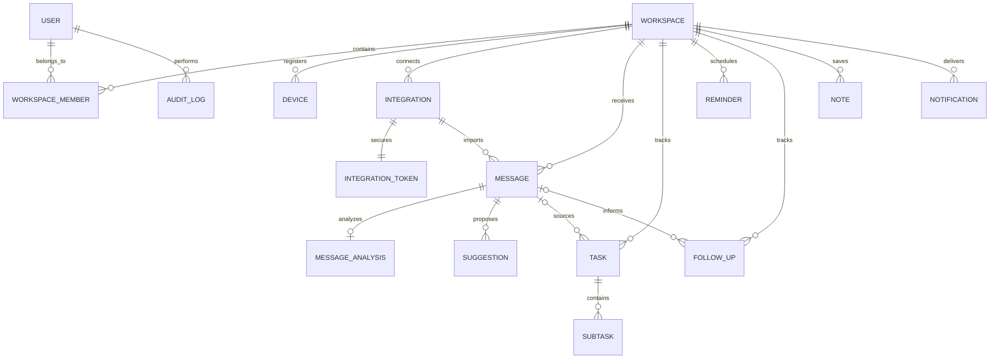

# Database Design

## Conventions

- PostgreSQL with UUID primary keys and Prisma migrations.
- Persist timestamps in UTC; store an IANA timezone on the user profile.
- Add `created_at` and `updated_at` to mutable records.
- Scope user content by `workspace_id`; enforce membership authorization in the API.
- Encrypt OAuth credentials with a server-managed key; never return token values in API responses.
- Deduplicate integration events with a unique `(integration_id, external_id)` constraint.
- Prefer explicit retention/deletion policies over indiscriminate soft deletion.

## Initial entity relationship

## Core tables

`users`, `workspaces`, `workspace_members`, `devices`, `integrations`, and `integration_tokens` establish identity, tenancy, device sessions, and server-side provider credentials. `messages` stores normalized source metadata and content with provider deduplication. `message_analysis` stores versioned validated model output; `extracted_entities` stores typed dates and entities. `suggestions` are approval-gated and idempotent. `tasks`, `subtasks`, `reminders`, `follow_ups`, `notifications`, `notes`, `embeddings`, and `audit_logs` are workspace-scoped records.

Suggested indexes include `(workspace_id, status, due_at)` for tasks, `(workspace_id, received_at)` for messages, `(integration_id, external_id)` unique for event deduplication, `(workspace_id, archived_at, priority)` for inbox retrieval, and `(workspace_id, scheduled_at, completed_at)` for reminders.

Embeddings use pgvector with a model/version field and an index chosen after measuring the target corpus. Message retention and embedding deletion follow the user's retention settings.

## Migration status

The Prisma schema is present at `infrastructure/database/schema.prisma`, including vector-backed embeddings and the core workspace entities. A migration has not yet been created or applied. Apply migrations only after PostgreSQL with the pgvector extension is running. Do not treat the browser preview's example records as deployed database rows.